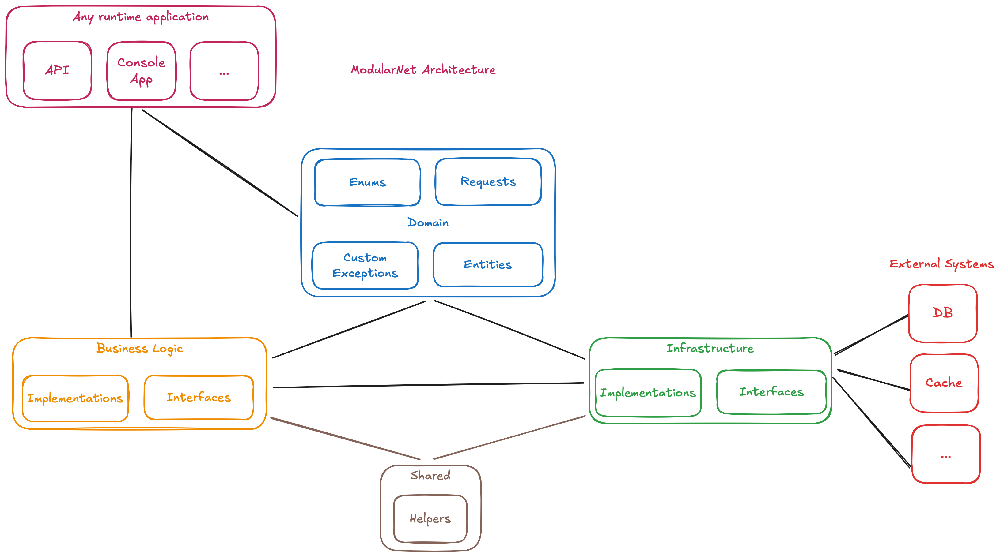

# ModularNet

## Introduction

**ModularNet** is a layered, modular architecture for building maintainable and testable .NET applications (.NET 10). It enforces a strict separation of concerns through interface-based communication and Dependency Injection across five layers (`Api`, `Business`, `Domain`, `Infrastructure`, and `Shared`), keeping all business logic isolated from API entry points and external infrastructure.

This repository also serves as a ready-to-use template featuring:
- User registration and authentication with **Google Firebase**
- Token validation and scope-based authorization
- Transactional email sending via **Azure Communication Services**
- Secrets management via **Azure Key Vault**
- In-memory and **Redis** caching
- Structured logging and auditing with **Serilog** and **MySQL**
- Unit of Work pattern coordinating atomic **Dapper** transactions across repositories

## Architecture & Coding Standards

All architectural rules, layer responsibilities, differences from Onion Architecture, naming conventions, testing practices, and feature implementation guidelines are documented in **[Coding Standards](coding-standards.md)**.

## Tech Stack & Dependencies

- **Framework:** .NET 10 (ASP.NET Core Web API)
- **Authentication:** Firebase Admin SDK & JWT Bearer Authentication
- **Authorization:** `Microsoft.Identity.Web` (`[Authorize]` and `[RequiredScope]`)
- **Database:** MySQL (`MySqlConnector`, `Dapper`, Unit of Work pattern, schema in [`database/database_schema.sql`](database/database_schema.sql))
- **Caching:** In-Memory cache & Azure Cache for Redis (`StackExchange.Redis`)
- **Emailing:** Azure Communication Services Email (`Azure.Communication.Email`)
- **Secrets Management:** Azure Key Vault (`Azure.Security.KeyVault.Secrets` & `Azure.Identity`)
- **Logging & Telemetry:** Serilog & Azure Application Insights
- **Testing:** xUnit & Moq (`ModularNet.UnitTests` and `ModularNet.IntegrationTests`)

## Documentation & Community

- **[Coding Standards](coding-standards.md):** Architecture rules, conventions, and step-by-step feature guide.
- **[Wiki](https://github.com/ale206/ModularNet/wiki):** Component-by-component reference for the solution.
- **[Discussions](https://github.com/ale206/ModularNet/discussions):** Ideas, questions, and feedback. Contributions and Pull Requests are welcome!
