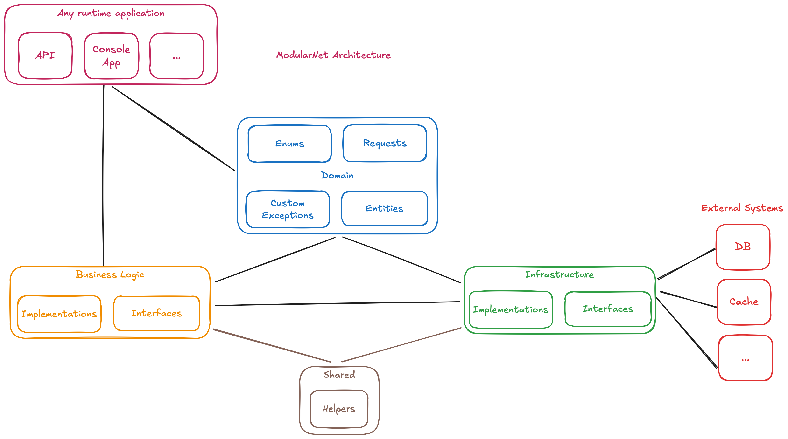

# ModularNet

[](https://github.com/ale206/ModularNet/actions/workflows/unit-tests.yml)
[](https://github.com/ale206/ModularNet/actions/workflows/unit-tests.yml)
[](https://hub.xerj.org/contributors/ale206)



## Introduction

**ModularNet** is a layered, modular architecture for building maintainable and testable .NET applications (.NET 10). It enforces a strict separation of concerns through interface-based communication and Dependency Injection across five layers (`Api`, `Business`, `Domain`, `Infrastructure`, and `Shared`), keeping all business logic isolated from API entry points and external infrastructure.

This repository also serves as a ready-to-use template featuring:
- User registration and authentication with **Google Firebase**
- Token validation and scope-based authorization
- Transactional email sending via **Azure Communication Services**
- Secrets management via **Azure Key Vault**
- In-memory and **Redis** caching
- Structured logging and auditing with **Serilog** and **MySQL**
- Unit of Work pattern coordinating atomic **Dapper** transactions across repositories

## Architecture & Coding Standards

All architectural rules, layer responsibilities, differences from Onion Architecture, naming conventions, testing practices, and feature implementation guidelines are documented in **[Coding Standards](coding-standards.md)**.

## Tech Stack & Dependencies

- **Framework:** .NET 10 (ASP.NET Core Web API)
- **Authentication:** Firebase Admin SDK & JWT Bearer Authentication
- **Authorization:** `Microsoft.Identity.Web` (`[Authorize]` and `[RequiredScope]`)
- **Database:** MySQL (`MySqlConnector`, `Dapper`, Unit of Work pattern, schema in [`database/database_schema.sql`](database/database_schema.sql))
- **Caching:** In-Memory cache & Azure Cache for Redis (`StackExchange.Redis`)
- **Emailing:** Azure Communication Services Email (`Azure.Communication.Email`)
- **Secrets Management:** Azure Key Vault (`Azure.Security.KeyVault.Secrets` & `Azure.Identity`)
- **Logging & Telemetry:** Serilog & Azure Application Insights
- **Testing:** xUnit & Moq (`ModularNet.UnitTests` and `ModularNet.IntegrationTests`)

## Documentation & Community

- **[Coding Standards](coding-standards.md):** Architecture rules, conventions, and step-by-step feature guide.
- **[Wiki](https://github.com/ale206/ModularNet/wiki):** Component-by-component reference for the solution.
- **[Discussions](https://github.com/ale206/ModularNet/discussions):** Ideas, questions, and feedback. Contributions and Pull Requests are welcome!

## Multiple infrastructure implementations

The cache registrations demonstrate one contract, `ICacheRepository`, backed by the existing in-memory and Redis repositories. `AddInfrastructureServices` registers each adapter with a `CacheType` key. Both can be used in the same scope; Redis still requires its normal connection configuration.

`CacheManager` injects both keyed adapters and selects one using `CacheType`. Other managers use `ICacheManager`, as in `UsersSettingsManager`. To inject a known backend into its corresponding manager:

```csharp
public CacheManager(
    [FromKeyedServices(CacheType.InMemory)] ICacheRepository cacheRepository)
{
    _cacheRepository = cacheRepository;
}
```

Import `Microsoft.Extensions.DependencyInjection`, `ModularNet.Domain.Enums`, and `ModularNet.Infrastructure.Interfaces`. Use `CacheType.Redis` for Redis. The current `CacheManager` injects both keys, so removing a registration requires updating its constructor and selection logic. A manager designed for a single backend can inject just that keyed implementation. For runtime selection, resolve the requested key within the current DI scope with `GetRequiredKeyedService<ICacheRepository>(cacheType)`. An unknown or unregistered key fails rather than silently selecting another backend. Avoid resolving scoped services from the root provider.

To add a backend, implement the contract, register it with a distinct key and appropriate lifetime, and test all contract operations. Do not register multiple unkeyed implementations expecting ordinary injection to select between them: .NET resolves the last registration for a single service; `IEnumerable<ICacheRepository>` returns all unkeyed registrations.

The adapters preserve the existing cache API and lifetimes. They are an example of selection, not database provider implementations. To add PostgreSQL or another database, implement provider-specific repositories and SQL, connection factory, and transaction handling; select a consistent set together. The current MySQL repositories contain provider-specific SQL. Repositories participating in one unit of work must share the same scoped connection and transaction; keyed registration alone does not make cross-provider transactions atomic. Test each provider against its actual database, including commit and rollback.

Interfaces currently live in Infrastructure under the project's coding standards. Multiple implementations can coexist there in provider-specific folders. If provider dependencies or independent deployment justify separate projects, first move shared contracts to an Infrastructure abstractions project, then have Business and each provider project reference it; keep registration in the application composition root. This adds project and migration overhead, so the template keeps its existing layout until that separation is needed.

### Disabled cache behavior

`AppSettings:ModularNetConfig:RedisCacheEnabled` and `MemoryCacheEnabled` control the underlying repositories, not DI registrations. When the selected cache is disabled, reads return `default` (a cache miss for reference types), and writes and removals do nothing. Redis is not contacted and there is no automatic fallback to memory. `UsersSettingsManager` handles a cache miss through `ICacheManager` by reading the database. This also means disabled caching increases database traffic. Enable Redis and configure its connection before selecting it if caching is required. For value types, `default` cannot distinguish a cache miss from a cached default value.

`UsersManager.GetUserFirstNameByUserId` shows a consumer choosing `CacheType.InMemory` through `ICacheManager`. Change its `CacheType` constant to `CacheType.Redis` to use Redis. On a miss it loads the user through `IUsersRepository` and caches the first name for five minutes. If names can change, invalidate the same key on update or choose an acceptable expiration; disabled caching always reads the user.
